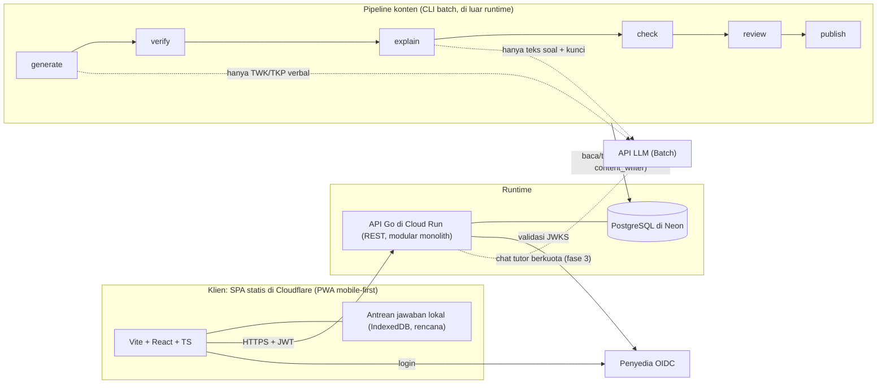

# Arsitektur: Latih Seleksi

Status: draf v0.2. Turunan dari `docs/prd.md` (§6 kebutuhan, §7 invarian, §9 model data, §10 stack, §11 non-fungsional). UI mengacu ke `docs/mockup/latih-seleksi.html`. Bila PRD §10 berbeda dengan dokumen ini (PRD masih menyebut Next.js), dokumen ini yang berlaku untuk stack.

Penanda: **[Putusan]** = diambil di dokumen ini dan perlu persetujuan, **[Dikonfirmasi]** = sudah disetujui pemilik proyek, **Asumsi (belum pasti)** = belum diverifikasi, **[Terbuka]** = keputusan milik pemilik proyek (PRD §13), **(rencana)** = dirancang tetapi belum ada di repositori.

Yang sudah dibangun (slice 1): API Go + Postgres + SPA Vite untuk mode drill pola persentase berantai, tanpa auth. Bagian lain adalah rancangan target.

## 1. Prinsip desain

Setiap prinsip dipetakan ke invarian PRD §7 supaya tidak bisa dilanggar tanpa sengaja.

| Prinsip | Konsekuensi arsitektur | Invarian |
|---|---|---|
| Kunci berasal dari kode, kutipan, atau manusia | Modul `generator`/`solver` menghasilkan kunci. Kolom kunci TWK wajib punya `citation`. Bobot TKP hanya bisa diisi lewat tindakan `reviewer`. Tidak ada jalur kode yang menulis kunci dari keluaran LLM. | 1 |
| Penjelasan ditulis setelah kunci tetap | Pipeline konten berurutan dan satu arah: kunci → penjelasan → cek otomatis → review → terbit. | 2 |
| Bank soal pra-generasi | Pipeline berjalan sebagai CLI batch terpisah dari runtime. Runtime hanya membaca soal berstatus `published`. | 4 |
| Tidak ada data pribadi ke LLM | Pipeline dan chat tutor tidak punya akses ke tabel pengguna (peran DB dan proses terpisah). | 6 |
| Spesifikasi ujian adalah data | Tabel `exam_spec` berversi. Kode tidak memuat angka 110, 100, 65, 80, 166. | PRD §8 |
| Generator wajib diuji terhadap hitungan independen | Setiap solver punya uji properti. CI menolak pola tanpa uji. | CLAUDE.md |
| Ringan untuk satu pengembang | **Modular monolith**, bukan microservices. Satu biner API, satu database. | n/a |

## 2. Gambaran sistem



Batas kepercayaan: klien tidak dipercaya untuk waktu, skor, maupun kunci. Pipeline konten tidak dipercaya untuk status `published` (hanya `reviewer` yang bisa mengubahnya).

Produksi tidak punya server aplikasi untuk frontend: hasil `vite build` adalah berkas statis. Satu-satunya proses yang berjalan adalah API Go. Lokal, `docker-compose.yml` menjalankan tiga layanan: `postgres`, `api`, dan `web` (nginx yang menyajikan SPA dan meneruskan `/v1` ke `api`).

## 3. Putusan teknologi

| Area | Pilihan | Alasan | Catatan |
|---|---|---|---|
| Backend | Go, `net/http` (ServeMux Go 1.22) + `pgx`. Migrasi SQL di-embed dan dijalankan API saat start (`api/db/migrations`, `store.Migrate`). | Satu binary kecil, cocok untuk container (PRD §10). SQL eksplisit cocok untuk data respons. | **[Dikonfirmasi]** Go. `chi`, `sqlc`, dan `goose` dari draf awal belum dipakai (`api/go.mod` hanya memuat `pgx`); tambahkan hanya bila kebutuhan nyata muncul. |
| Database | PostgreSQL 16 | `jsonb` untuk opsi/parameter, transaksi untuk skoring, partial index untuk antrean drill. | Satu instance cukup untuk MVP. |
| Frontend | **[Putusan]** SPA statis: Vite + React + TypeScript. Rencana: `vite-plugin-pwa` (service worker), Dexie (IndexedDB) untuk antrean jawaban, TanStack Query bila perlu. | Tanpa runtime server di produksi, jadi permukaan serangan lebih kecil dan hosting statis gratis. Next.js dibuang atas preferensi pemilik proyek (banyak CVE, tidak mau bergantung pada Vercel). PWA mobile-first tetap tercapai. | Terpasang saat ini: React, Vite, Vitest (`web/package.json`). Pustaka PWA/Dexie/TanStack **belum** dipasang, jadi versinya belum dikunci. Server dev Vite hanya untuk `localhost` (`web/vite.config.ts`); jangan diekspos (catatan proyek menyebut ada CVE pada dev server Vite; **Asumsi (belum pasti):** belum diperiksa ulang). |
| Auth | OIDC. **[Putusan]** MVP memakai penyedia terkelola, backend hanya memvalidasi JWT lewat JWKS. | Riset menunjukkan masalah login adalah keluhan terbesar (26,5%, PRD §2). Mengoperasikan Keycloak sendiri menambah beban operasional pengembang tunggal. | **[Terbuka]** Keycloak self-host (PRD §13.1) bisa menggantikan karena backend hanya bergantung pada standar OIDC, bukan pada vendor. |
| Penjadwal ulang | FSRS dengan parameter bawaan | PRD FR-11. | **Asumsi (belum pasti):** ketersediaan dan kualitas pustaka Go untuk FSRS belum diperiksa. Fallback: implementasi sendiri, rumusnya publik dan kecil. |
| LLM | Batch API, model murah, hanya di pipeline | Biaya pra-generasi 5.000 soal sekitar USD 4–340 menurut hitungan riset (asumsi token, belum diukur). | Model dan harga dicek ulang saat anggaran ditetapkan. |
| Hosting | **[Dikonfirmasi]** Cloudflare (SPA statis) + Cloud Run (container API Go) + Neon (PostgreSQL). Lokal: Docker Compose. Tidak ada VPS. | Pemilik proyek ingin hosting gratis tanpa Vercel. Cloudflare Free melayani aset statis, tetapi Workers dibatasi (CPU 10 ms) dan Go hanya lewat WASM, jadi API tidak ditaruh di sana. `api/Dockerfile` sudah memakai `PORT` dari Cloud Run. | **Asumsi (belum pasti):** angka kuota gratis Cloud Run, Neon, dan Cloudflare belum diverifikasi; cek halaman harga resmi sebelum deploy. Cloud Run membutuhkan akun penagihan Google (kartu). Neon memerlukan `sslmode=require` (`.env.example`). Belum pernah di-deploy. |
| CI | GitHub Actions atau setara: lint, tipe, uji unit, uji migrasi, E2E alur simulasi | Lihat §12. | Bukan full-suite pada setiap edit lokal. |

## 4. Struktur repositori

Satu monorepo (`github.com/dhaniarfebrin/latih-seleksi`). Baris tanpa tanda sudah ada; **(rencana)** belum ada.

```
latih-seleksi/
  docs/                 PRD, riset, mockup, dokumen ini
  docker-compose.yml    postgres + api + web (nginx) untuk lokal
  api/                  Go (Dockerfile untuk Cloud Run)
    cmd/
      api/              server HTTP
      content/          CLI: saat ini mencetak soal + kunci dari generator;
                        (rencana) pipeline generate|verify|explain|check|review|publish
    internal/
      gen/              antarmuka keluarga + generator templat + solver
        persentase/     keluarga persentase berantai (+ uji)
        kerjasama/      keluarga kerja sama (+ uji)
        kecepatan/      keluarga kecepatan relatif (+ uji)
        catalog/        daftar berurutan semua keluarga (dipakai drill dan cmd/content)
      drill/            layanan sesi drill (pembuatan sesi, jawaban, submit)
      store/            akses Postgres (pgx) dan penjalan migrasi
      httpx/            router net/http, request id, access log, CORS
      spec/             spesifikasi ujian: tipe, parsing ketat, Validate, registri
        data/           skd-2024.json, skd-sekolah-kedinasan-2026.json (go:embed)
      content/          (rencana) item, status, state machine, kutipan
      exam/             (rencana) sesi simulasi, timer server
      scoring/          skor per subtes dan per jalur, ambang, status lulus
      mastery/          (rencana) akurasi per pola, klasifikasi sebab, FSRS
      report/           (rencana) laporan soal dan riwayat koreksi
      account/          (rencana) profil, ekspor, hapus
    db/
      migrations/       SQL, di-embed ke biner (db.go)
  web/                  SPA Vite + React + TS (Dockerfile + nginx.conf untuk lokal)
    src/                App.tsx, api.ts, session.ts (+ uji)
  .github/workflows/    (rencana)
```

Paket `drill` dan `store` lahir di slice 1 untuk mode drill saja. **[Putusan]** Saat `exam`, `scoring`, dan `mastery` dibangun, `drill` menyusut menjadi pemilih soal di atasnya; jangan menambah logika skor atau sesi ke `drill`.

Aturan ketergantungan (berlaku untuk paket target): `exam` boleh memakai `spec`, `scoring`, `content`. `mastery` boleh membaca respons. `gen` tidak boleh mengimpor `exam`, `drill`, `store`, maupun `account`. Aturan ini dijaga dengan uji impor atau `go-arch-lint` (**Asumsi (belum pasti):** alat belum dipilih).

## 5. Spesifikasi ujian sebagai data

Spesifikasi berupa berkas JSON di `api/internal/spec/data/`, di-embed ke biner (`go:embed` tidak bisa keluar dari modul `api/`). `spec.Load` mem-parse ketat (field tak dikenal ditolak) dan memvalidasi semuanya saat start; tabel `exam_spec` (langkah berikutnya) hanya menyimpan salinan untuk riwayat hasil. Ada dua berkas karena TKP-nya berbeda: `skd-2024` (KepmenPANRB 321/2024, scope `cpns`) dan `skd-sekolah-kedinasan-2026` (KepmenPANRB 406/2026, scope `sekolah-kedinasan`). Angka berasal dari `docs/research/notes/spesifikasi_resmi.md` §1:

```json
{
  "id": "skd-2024",
  "label": "SKD CPNS 2024",
  "source": "KepmenPANRB 321/2024",
  "source_url": "https://data-jdih.menpan.go.id/dokumen/2024kepmenpanrb321.pdf",
  "enacted_on": "2024-07-29",
  "scope": "cpns",
  "duration_min": 100,
  "sections": [
    { "id": "TWK", "label": "Tes Wawasan Kebangsaan", "items": 30, "scoring": { "kind": "right-wrong", "correct": 5 }, "aspects": ["nasionalisme","integritas","bela-negara","pilar-negara","bahasa-negara"] },
    { "id": "TIU", "label": "Tes Intelegensia Umum", "items": 35, "scoring": { "kind": "right-wrong", "correct": 5 } },
    { "id": "TKP", "label": "Tes Karakteristik Pribadi", "items": 45, "scoring": { "kind": "weighted", "min": 1, "max": 5 }, "aspects": ["pelayanan-publik","jejaring-kerja","sosial-budaya","tik","profesionalisme","anti-radikalisme"] }
  ],
  "tracks": [
    { "id": "umum",     "label": "Kebutuhan umum", "thresholds": { "TWK": 65, "TIU": 80, "TKP": 166 } },
    { "id": "cumlaude", "label": "Cumlaude dan diaspora", "total_min": 311, "thresholds": { "TIU": 85 } },
    { "id": "afirmasi", "label": "Penyandang disabilitas, putra/putri Papua, daerah tertinggal", "total_min": 286, "thresholds": { "TIU": 60 } }
  ],
  "max_total": 550
}
```

`tracks` berupa array supaya urutan tampilan stabil. Sebuah jalur lulus bila semua `thresholds` terpenuhi dan `total_min` (bila ada) terpenuhi; subtes tanpa ambang di jalur itu tidak bisa gugur. Skor `blank` dan `wrong` bernilai 0 bila tidak ditulis.

- Validator `spec.Validate` memeriksa konsistensi: skor maksimum subtes = jumlah soal × bobot tertinggi, `max_total` sama dengan jumlah skor maksimum subtes, ambang tidak melebihi skor maksimum subtes, id unik. Ini menangkap salah ketik angka sebelum dipakai. `scoring.Score` hanya menghitung dari titik per butir (`Response`) terhadap spec dan jalur; ia tidak tahu soal.
- Versi baru ditambahkan sebagai berkas baru, tidak mengubah yang lama, supaya riwayat hasil tetap bisa dinilai ulang dengan spesifikasi yang berlaku saat itu.
- Per 14 Nov 2026 Kepmen ambang CPNS 2026 belum ditemukan. Ambang 2024 tampil dengan label tahun di UI (FR-02). Jalur lain yang tidak memiliki ambang per subtes (total saja) ditangani oleh bentuk `tracks` di atas.

## 6. Model data

Mengembangkan PRD §9. Hanya bagian yang menentukan arsitektur yang dirinci.

**[Putusan, simulasi parsial TIU, 2026-11-15]** Dua penyimpangan dari skema di bawah: (1) tidak ada tabel `exam_spec`; `attempt` menyimpan `spec_id` dan `spec_body jsonb` (salinan beku spec), karena spec sudah di-embed dan tabel kembar rawan beda. (2) Sesi simulasi memakai rute `/v1/exams` (`GET /specs`, `POST /exams`, `GET /exams/{id}`, `PUT /exams/{id}/responses/{pos}`, `POST /exams/{id}/submit`, `GET /exams/{id}/result`), terpisah dari `/v1/attempts` (§7), supaya `drill` tidak mendapat logika skor/sesi. Sampai bank TWK/TKP cukup, simulasi hanya untuk subtes yang punya sumber soal (sekarang TIU): hasilnya skor TIU vs ambang TIU tanpa status lulus keseluruhan, durasi = durasi spec x jumlah soal/total soal, ditandai `duration_basis: "prorated"` (angka prorata bukan dari sumber resmi). Toleransi 5 detik diterapkan di `exam` (lazy: sesi dikunci saat dibaca setelah `deadline_at` + 5 detik).

```sql
-- Konten
pattern(id text pk,            -- 'TIU.numerik.persentase-berantai'
        section text, aspect text, label text, target_sec int);

item(id uuid pk, pattern_id text fk, kind text check (kind in ('template','bank')),
     version int, status text check (status in ('draft','verified','published','retired')),
     stem text, options jsonb,            -- [{key:'A', text, weight?, misconception_id?}]
     answer_key text,                     -- null untuk TKP
     explanation text,
     citation jsonb,                      -- {doc, locator, quote}  (wajib untuk TWK)
     provenance jsonb,                    -- {generator, seed, model, verifier, reviewer, run_id}
     content_hash text, created_at timestamptz);

item_template(id text pk, pattern_id text fk, params_schema jsonb, solver text,
              distractor_rules jsonb);    -- label miskonsepsi per aturan pengecoh

item_revision(item_id, version, changed_at, reason, report_id);   -- riwayat koreksi publik
item_report(id, item_id, user_id, reason, status, created_at);

-- Spesifikasi
exam_spec(id text pk, label text, source text, body jsonb, active bool);

-- Pengguna dan aktivitas
attempt(id uuid pk, user_id, spec_id, track text, mode text check (mode in ('simulasi','drill')),
        started_at, deadline_at, submitted_at, status text);
attempt_item(attempt_id, pos int, item_snapshot jsonb,  -- salinan beku soal saat sesi dibuat
             item_id uuid, item_version int, primary key (attempt_id, pos));
response(attempt_id, pos, answer text, score int, time_ms int, flagged bool,
         client_seq int, answered_at timestamptz, primary key (attempt_id, pos));
mastery(user_id, pattern_id, n int, correct int, ema_time_ms int,
        fsrs jsonb, updated_at, primary key (user_id, pattern_id));
```

Putusan data penting:

1. **Snapshot beku (`attempt_item.item_snapshot`).** Soal templat dimaterialisasi dari `template + seed` saat sesi dibuat, lalu disimpan. Koreksi atau penarikan soal tidak mengubah riwayat, dan hasil bisa direproduksi. Generator tetap deterministik untuk seed yang sama (FR-06).
2. **Kunci tidak dikirim ke klien sebelum waktunya.** Respons API sesi tidak memuat `answer_key`, `weight`, dan `explanation`. Pada mode simulasi, hal itu baru tersedia setelah submit. Pada mode drill, tersedia per soal sesudah jawaban dikirim.
3. **Skor dihitung server** dari snapshot dan spesifikasi sesi, bukan dari angka kiriman klien.
4. **Invarian di database.** Constraint dan trigger menolak: status `published` untuk soal TWK tanpa `citation`; status `published` untuk soal tanpa `answer_key` kecuali TKP dengan semua bobot terisi; loncatan status di luar `draft → verified → published → retired`. Ini lapis terakhir bila kode aplikasi salah.
5. **`response` mencatat semua respons sejak hari pertama** (FR-11): `time_ms`, opsi terpilih, mode. Data ini cukup untuk kalibrasi Rasch nanti tanpa migrasi.

Indeks utama: `response(attempt_id)`, `attempt(user_id, started_at desc)`, `mastery(user_id)`, `item(pattern_id) where status='published'`.

## 7. API (REST, OpenAPI sebagai sumber kebenaran)

Semua rute di bawah `/v1`, otentikasi JWT kecuali dinyatakan lain. Klien TypeScript dibangkitkan dari berkas OpenAPI.

| Rute | Fungsi | FR |
|---|---|---|
| `GET /specs/active` | spesifikasi aktif dan jalur | FR-02 |
| `POST /attempts` `{mode, track, pattern_id?, n?}` | membuat sesi. Server memilih dan membekukan soal, menetapkan `deadline_at`. | FR-01, FR-05 |
| `GET /attempts/{id}` | metadata sesi, soal tanpa kunci, jawaban tersimpan, sisa waktu server | FR-01 |
| `PUT /attempts/{id}/responses/{pos}` `{answer, time_ms, flagged, seq}` | simpan jawaban, idempotent. Pada drill mengembalikan kunci dan penjelasan bila salah. | FR-01, FR-04 |
| `POST /attempts/{id}/submit` | kunci sesi, hitung skor | FR-01 |
| `GET /attempts/{id}/result` | skor per subtes vs ambang, poin hilang per pola | FR-02 |
| `GET /attempts/{id}/review?filter=` | per soal: jawaban, kunci, waktu vs median, penjelasan, kutipan, status verifikasi | FR-03 |
| `GET /dashboard` | akurasi dan waktu per subtes dan pola, tren, label sebab, antrean drill | FR-10 |
| `GET /drill/recommendation` | pola terlemah | FR-05, FR-10 |
| `POST /items/{id}/reports` | laporkan soal | FR-03 |
| `GET /items/{id}/history` | riwayat koreksi (publik) | PRD §7.7 |
| `GET /me` · `POST /me/export` · `DELETE /me` | profil, ekspor, hapus | FR-12 |
| `GET /healthz` (tanpa auth) | pemeriksaan hidup | n/a |

Rate limit per pengguna pada rute tulis. Semua rute tulis menerima `Idempotency-Key` atau `seq` agar pengulangan aman.

## 8. Mesin simulasi dan ketahanan

Target: simulasi tahan reload dan sinyal putus (PRD §11).

- **Waktu otoritatif di server.** `deadline_at = started_at + duration`. Penghitung mundur di klien hanya tampilan. Server menerima `PUT` sampai `deadline_at` ditambah toleransi kecil (**Asumsi (belum pasti):** 5 detik, perlu ditentukan), lalu menolak.
- **Auto-submit tidak bergantung pada klien.** Sesi yang lewat `deadline_at` dikunci dan dinilai saat pertama kali dibaca (lazy) dan oleh pekerjaan terjadwal berkala. Tidak perlu antrean pesan.
- **Antrean lokal.** Klien menulis setiap jawaban ke IndexedDB lebih dulu, lalu mengirim di latar belakang dengan `seq` naik. Server menerapkan "seq terbaru menang" per `(attempt, pos)`. Indikator "Tersimpan otomatis" di UI mencerminkan antrean kosong. Bila ada antrean tertunda, indikator berubah menjadi "Menunggu sinyal".
- **Lanjut setelah reload.** `GET /attempts/{id}` mengembalikan jawaban tersimpan dan sisa waktu server. Klien menggabungkannya dengan antrean lokal.
- **Pemilihan soal simulasi.** Komposisi diambil dari `exam_spec`. Per subtes dipilih soal `published` yang belum pernah dilihat pengguna, tersebar di pola sesuai bobot kisi-kisi. Bila bank belum cukup (tahap awal), sistem mengizinkan ulang soal lama dan memberi tahu pengguna. Detail bobot per pola **Asumsi (belum pasti)** karena regulasi tidak membagi jumlah soal per sub-materi (`spesifikasi_resmi.md` Gaps).

## 9. Generator, solver, dan pipeline konten

### 9.1 Generator templat (TIU numerik dan silogisme)

Satu paket Go per keluarga (`gen/persentase`, `gen/kerjasama`, `gen/kecepatan`, dst.) dengan antarmuka yang sama; `gen/catalog` mendaftarkan semuanya:

```go
type Family interface {
    ID() string
    Label() string                                       // nama pola untuk UI
    Misconceptions() map[string]string                   // id miskonsepsi -> label (unik per pola)
    Generate(seed int64, band Band) (Draft, error)       // deterministik untuk seed sama
}
```

- Kunci dan langkah penyelesaian dihitung di dalam paket keluarga (solver internal), bukan di antarmuka. Independensi kunci dijaga oleh uji properti yang menghitung ulang jawaban hanya dari teks soal. Pengecoh dibangkitkan dari aturan miskonsepsi berlabel (misal "menjumlahkan persentase langsung" pada persentase berantai) sehingga opsi salah memiliki `misconception_id`. Label ini dilayani `GET /v1/patterns` (`misconceptions`) dan dipakai UI drill ("Kenapa A salah") dan klasifikasi sebab. Id hanya unik per pola, jadi klien mencari label lewat `pattern_id` percobaan.
- Enam keluarga MVP sesuai FR-06: persentase berantai, kerja-sama, kecepatan relatif, rata-rata gabungan, deret angka, perbandingan. Silogisme (FR-07) memakai pemeriksa keabsahan dari aturan logika formal.
- Uji wajib per keluarga: (a) properti: untuk ribuan seed, `answer_key` sama dengan penghitung independen yang ditulis terpisah di berkas uji, (b) tepat satu opsi benar, (c) tidak ada dua opsi bernilai sama, (d) determinisme seed.

### 9.2 Pipeline (CLI `content`)

```
generate → verify → explain → check → review → publish
```

| Tahap | Isi | Menjaga invarian |
|---|---|---|
| `generate` | Templat: panggil generator. TWK: ambil kutipan dari korpus sumber lalu susun soal dari kutipan. TKP: LLM mendraf situasi dan opsi. Tulis `draft`. | 1, 5 |
| `verify` | Templat: kunci sudah by construction. TWK/verbal buatan LLM: **tiga kali** diselesaikan solver dengan urutan opsi diacak. Tidak sepakat masuk antrean review manusia. | 3 |
| `explain` | LLM menulis penjelasan yang dibatasi pada kunci tetap. Input hanya teks soal, kunci, langkah, kutipan. Tanpa data pengguna. | 2, 6 |
| `check` | Otomatis: angka akhir di penjelasan cocok dengan kunci, pasal yang dikutip benar-benar ada di korpus, format valid. Gagal berarti kembali ke `draft`. | 2 |
| `review` | Manusia memeriksa: semua TKP (menetapkan bobot 1–5), semua soal LLM yang tidak disepakati, dan sampel acak dari yang disepakati. Menaikkan ke `verified`. | 1, 3 |
| `publish` | `verified → published`. Semua cek constraint database dijalankan. Menulis `item_revision`. | PRD §7.7 |

- Setiap berjalan mencatat `run_id`, model, versi prompt, dan biaya ke `provenance`. Ini diperlukan karena angka biaya riset masih berupa asumsi token yang belum diukur.
- Alat review di MVP berupa CLI interaktif atau halaman admin kecil yang tidak dipublikasikan. **[Terbuka]** siapa peninjau kedua untuk TKP dan TWK (PRD §13.3). Tanpa peninjau kedua, kapasitas review menjadi batas ukuran bank soal.
- Pipeline memakai peran DB `content_writer` yang hanya bisa menulis `item`, `item_template`, `item_revision`. Peran ini tidak bisa membaca `attempt`, `response`, atau data pengguna.
- Soal yang dilaporkan valid menurunkan status ke `verified` atau `retired`, dan tercatat di `item_revision` yang tampil di UI (tautan "Riwayat koreksi").

### 9.x Bank TWK dan TKP (`api/internal/bank`)

Data ter-embed (`go:embed`, tanpa tabel DB dulu), pola sama dengan `spec`. `bank.Load` memvalidasi semuanya; entri tidak valid membuat muat gagal.

- **TWK:** `data/twk/*.json`, satu entri = aspek, rujukan pasal, kutipan, pertanyaan, kunci, 3-4 pengecoh. Kutipan wajib ada di korpus `data/corpus/<source_id>.txt` (salinan verbatim bunyi pasal, penanda catatan kaki dibuang); kunci wajib termuat dalam kutipan; pengecoh tidak boleh termuat dalam kutipan.
- **TKP:** `data/tkp/*.json`, 5 opsi berbobot 1-5, wajib merujuk butir perilaku di `data/rubric/se-20-2021.json` (SE MenPANRB 20/2021 angka 4). Bobot adalah penilaian penyusun dan berstatus `draft` sampai ditinjau manusia. UI wajib melabeli: "bobot TKP = penilaian penyusun, bukan kunci resmi".
- `status` `draft` atau `reviewed`; hanya `reviewed` dilayani `ItemSource.Pick`, yang mengembalikan `gen.Draft` sehingga drill dan simulasi tidak peduli asal soal.
- CLI: `go run ./cmd/bank check` (validasi + cakupan per aspek) dan `go run ./cmd/bank review` (cetak entri `draft`).

## 10. Diagnosis dan drill

### 10.1 Pembaruan mastery
Saat `response` ditulis (dalam transaksi yang sama), `mastery(user, pattern)` diperbarui: jumlah jawaban, benar, rata-rata waktu eksponensial. Akurasi yang dipakai untuk peringkat memakai penghalusan Beta supaya pola dengan 2 jawaban tidak mengalahkan pola dengan 20 jawaban.

### 10.2 Klasifikasi sebab kesalahan
Aturan murah berbasis sinyal yang sudah ada (laporan riset `ai_adaptif.md`):

| Label | Aturan awal | 
|---|---|
| Kurang paham | Pengecoh dengan `misconception_id` terpilih, atau akurasi pola < 50% dengan ≥ 4 jawaban | 
| Tekanan waktu | Salah dan `time_ms` > 1,3 × median soal, atau salah pada 20% terakhir waktu simulasi |
| Ceroboh | Salah dengan `time_ms` < 0,6 × median soal pada pola yang akurasinya ≥ 70% |

**Asumsi (belum pasti):** ambang 1,3 / 0,6 / 70% / 50% adalah titik awal tanpa dasar data. Riset menyatakan klasifikasi seperti ini belum pernah divalidasi untuk ujian pilihan ganda. Simpan ambang di konfigurasi, simpan label beserta aturan yang memicunya, dan evaluasi dengan data pengguna uji.

### 10.3 Pemilih drill
1. Pola terlemah: akurasi terhaluskan terendah, diberi bobot selisih terhadap target detik. 
2. Dalam pola: soal yang belum pernah dilihat lebih dulu. Untuk fakta TWK, soal yang jatuh tempo menurut FSRS didahulukan.
3. Sesi 5–10 soal. Pengguna dapat menimpa pilihan pola (layar mode).

### 10.4 Metrik uji produk
Target "TIU ≥7/10 dalam 9 menit" (PRD §5) dihitung dari `response` dan `attempt` dengan kueri tetap, supaya hasil pengguna uji terukur tanpa instrumen baru.

## 11. Keamanan, privasi, dan kepatuhan

- **Autentikasi:** klien memperoleh token dari penyedia OIDC. API memvalidasi `iss`, `aud`, `exp`, dan tanda tangan lewat JWKS ter-cache. Pengguna lokal dibuat saat token pertama (`sub` → `user`). Tidak ada kata sandi di database sendiri.
- **Otorisasi:** setiap kueri tabel pengguna dibatasi `user_id` dari token. Kandidat tambahan: Row Level Security di Postgres sebagai lapis kedua (**Asumsi (belum pasti):** biaya kompleksitas pada lapisan akses data `pgx` belum dinilai).
- **Peran DB terpisah:** `app_rw` (runtime), `content_writer` (pipeline), `readonly_analytics` (opsional, tanpa kolom identitas).
- **Data pribadi:** simpan seminimal mungkin (email, `sub`, jalur, riwayat). Persetujuan eksplisit di onboarding. Ekspor JSON dan hapus akun menghapus `attempt`, `response`, `mastery`, dan `user` secara berantai, dengan uji otomatis bahwa tidak ada baris yatim (UU 27/2022, FR-12).
- **LLM:** tidak ada identitas atau jawaban per pengguna dalam prompt. Chat tutor berkuota (fase 3) hanya mengirim `item_id` dan opsi yang dipilih, tanpa email atau `user_id`. Kuota dihitung di sisi server.
- **Hak cipta dan merek:** korpus pembuatan soal hanya dari sumber orisinal atau dokumen hukum. Tidak ada nama atau logo BKN, KemenPANRB, FHCI. Disclaimer dirender dari satu komponen yang dipakai di onboarding dan footer, dengan uji E2E bahwa ia ada (FR-13).
- **Pembayaran:** di luar MVP. Bila dibangun, `entitlement` hanya disimpan dan diperiksa di server, tidak dipercaya dari klien (PRD §4).
- **Rahasia:** kredensial LLM hanya ada di lingkungan pipeline, tidak di runtime API atau klien.

## 12. Strategi pengujian

| Lapis | Isi | Kapan jalan |
|---|---|---|
| Unit: solver/generator | Uji properti vs penghitung independen, determinisme seed, satu opsi benar | Tiap perubahan paket `gen/*` (wajib) |
| Unit: scoring | Semua kombinasi 5/0 dan 1–5, ambang per jalur, status gugur per subtes, spesifikasi tidak valid ditolak | Tiap perubahan `scoring`, `spec` |
| Integrasi DB | Constraint invarian (TWK tanpa kutipan tidak bisa terbit, loncatan status ditolak), migrasi naik-turun | CI |
| Kontrak API | Skema OpenAPI vs implementasi, respons sesi tidak memuat kunci | CI |
| E2E (Playwright) | Alur simulasi: mulai → jawab → reload → lanjut → auto-submit → hasil → review. Drill: salah → penjelasan muncul otomatis. Mode offline: jawab tanpa jaringan lalu sinkron. | Sebagai gerbang akhir, tidak pada tiap edit |
| Konten | Pemeriksa `check` dijalankan atas seluruh bank `published` pada tiap rilis konten | Rilis konten |

Cakupan ditargetkan per paket (solver, scoring), bukan angka global.

## 13. Operasional

- **Lingkungan:** `dev` (Docker Compose lokal: `postgres` di `127.0.0.1:5433`, `api` di `127.0.0.1:8080`, `web` nginx di `:8081`), `prod` (Cloudflare + Cloud Run + Neon). Staging ditunda sampai ada pengguna lain.
- **Deploy (rencana, belum dilakukan):** SPA: `vite build` ke Cloudflare. API: image dari `api/Dockerfile` ke Cloud Run dengan `DATABASE_URL` (Neon, `sslmode=require`) dan `CORS_ORIGIN` dari variabel lingkungan. **[Terbuka]** SPA dan API berbeda origin di produksi: pilih CORS dengan `CORS_ORIGIN` (sudah didukung `httpx`) atau rute `/v1` satu origin lewat Cloudflare. Lokal sudah satu origin lewat proxy nginx.
- **Migrasi:** SQL ter-embed dijalankan API saat start dengan kunci advisory Postgres agar instance paralel tidak berebut (`store.Migrate`, dicatat di `schema_migrations`). Migrasi harus maju-kompatibel satu versi, karena Cloud Run dapat menjalankan revisi lama dan baru bersamaan saat rilis. **Asumsi (belum pasti):** perilaku itu berasal dari model rilis Cloud Run yang belum saya verifikasi di dokumentasi resminya.
- **Pekerjaan terjadwal:** auto-submit (§8) memakai penilaian lazy saat sesi dibaca, sehingga tidak butuh proses latar. **Asumsi (belum pasti):** Cloud Run bisa turun ke nol instans, sehingga pekerjaan berkala butuh pemicu eksternal (mis. Cloud Scheduler); belum dipilih dan belum dicek harga/kuotanya.
- **Cadangan:** bergantung pada fitur Neon. **Asumsi (belum pasti):** retensi cadangan/restore di tier gratis Neon belum diperiksa; periksa halaman resmi sebelum deploy, dan bila tidak memadai, jadwalkan `pg_dump` berkala ke penyimpanan objek. Uji pemulihan tetap dijadwalkan.
- **Observabilitas:** log terstruktur dengan `request_id`, metrik dasar (latensi, error, antrean sinkron jawaban), pelaporan error. Alat tidak dipilih di dokumen ini.
- **Kinerja:** target soal termuat kurang dari 1 detik di 4G (PRD §11, **Asumsi (belum pasti)**). `GET /attempts/{id}` membawa seluruh soal sesi dalam satu respons agar navigasi antar soal tidak menunggu jaringan.
- **Konfigurasi:** variabel lingkungan untuk rahasia, berkas konfigurasi untuk ambang diagnosis.

## 14. Peta ke tahapan rilis (PRD §12)

| Fase | Komponen yang dibangun |
|---|---|
| 0. Validasi | `gen/persentase_berantai` + uji, CLI kecil yang mencetak 8 soal dan kunci. Tanpa web, tanpa auth, tanpa DB. Cukup untuk menguji apakah drill benar-benar menaikkan TIU. |
| 1. MVP SKD | `spec`, `content`, `exam`, `scoring`, `mastery`, DB, API, PWA, pipeline `generate → publish` untuk 6 keluarga TIU + silogisme + bank TWK/TKP awal sesuai kapasitas review, akun. |
| 2. BUMN | Tambah `exam_spec` baru dan pola AKHLAK/English. Struktur tidak berubah karena spesifikasi adalah data. |
| 3. Perluasan | Chat tutor berkuota (rute baru + penghitung kuota), generator figural (SVG), React Native memakai klien OpenAPI yang sama, pembayaran dengan entitlement di server. |

Urutan bangun fase 1 yang disarankan: `spec` + `scoring` (murni, mudah diuji) → `gen` untuk satu keluarga → `exam` + DB + API → PWA simulasi → drill dan mastery → pipeline konten → akun, ekspor, hapus.

## 15. Risiko dan keputusan terbuka

| Risiko / keputusan | Dampak | Mitigasi / langkah |
|---|---|---|
| ~~Go vs Laravel~~ **[Dikonfirmasi]** Go | Menentukan seluruh `api/` | Selesai; slice 1 sudah ditulis dengan Go. |
| **[Terbuka]** Layanan gratis (Cloud Run, Neon, Cloudflare) | Kuota atau syarat penagihan bisa berbeda dari catatan | Cek halaman harga resmi sebelum deploy; pasang batas biaya/anggaran di akun Google. |
| **[Terbuka]** Auth terkelola vs Keycloak | Beban operasional vs kontrol penuh | Mulai terkelola. Backend hanya bergantung pada OIDC standar, jadi bisa diganti. |
| **[Terbuka]** Peninjau kedua TKP/TWK | Kapasitas bank soal terbatas oleh review, bukan biaya LLM | Mulai dengan bank kecil bermutu. Batasi TKP sampai ada peninjau. |
| **[Terbuka]** Publik atau pribadi dulu | Menentukan kapan privasi, kuota, dan pembayaran perlu matang | Bangun auth dan hapus-data sejak awal karena murah di awal dan mahal bila ditambal. |
| Ambang CPNS 2026 belum terbit | Ambang di UI bisa usang | Spesifikasi berversi dan berlabel tahun. Tambah berkas baru saat Kepmen terbit. |
| Efektivitas FSRS untuk MCQ belum teruji | Penjadwalan TWK mungkin kurang tepat | Pakai parameter bawaan, catat semua respons, evaluasi sebelum mengubahnya. |
| Aturan klasifikasi sebab belum tervalidasi | Label bisa menyesatkan | Tampilkan sebagai petunjuk, simpan aturan pemicu, validasi dengan data pertama. |
| Biaya LLM berupa asumsi token | Anggaran meleset | Catat biaya per run di `provenance`, ukur sebelum batch besar. |
| Kunci salah lolos | Merusak kepercayaan, keluhan terbesar kedua (12,7%) | Kunci dari kode/kutipan/manusia, tiga kali solve, sampel review, laporan soal, riwayat koreksi publik. |

## 16. Hal yang sengaja tidak dirancang sekarang

Leaderboard, wawancara suara, video, soal figural, IRT, aplikasi native, pembayaran, dan modul BUMN (PRD §4). Struktur data dan API di atas tidak menutup jalan untuk semuanya.
